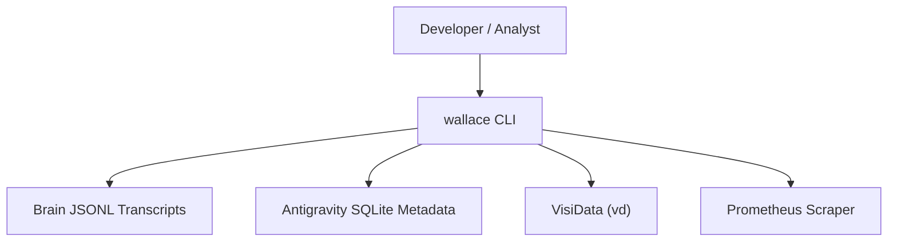
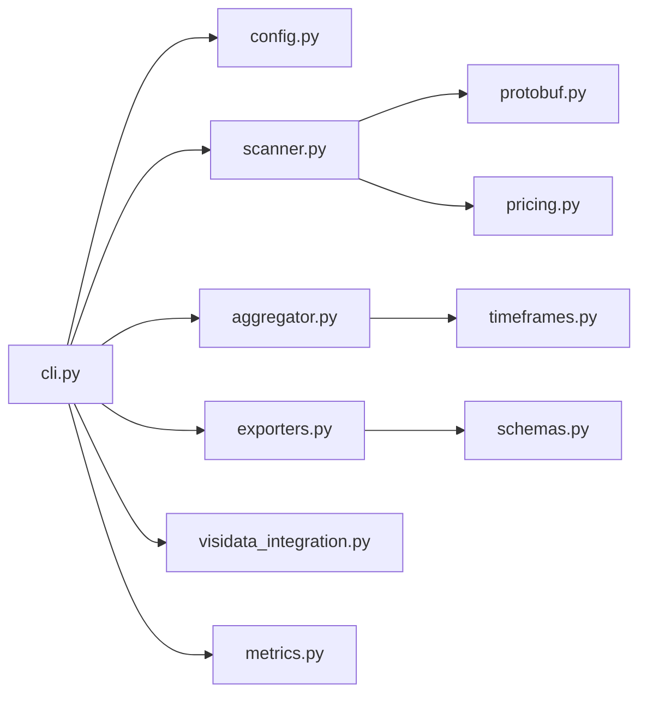
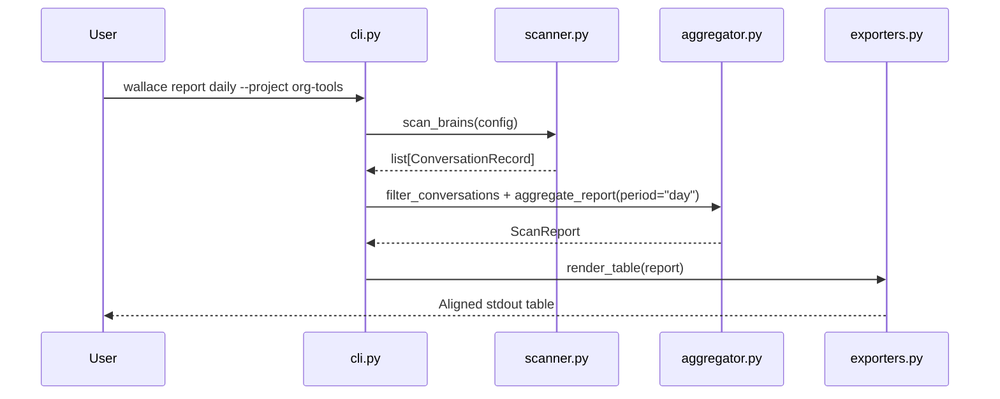

# Architecture (`arc42`)

## Overview

**What you will learn:**

- How `wallace` structures its internal modules, wire-format decoders, and rollup pipeline.
- How to run formatting, linting, static type checking, and automated contract tests via `mise`.

`wallace` keeps runtime dependencies minimal (`jsonschema` and `prometheus-client`) so brain directory scans stay fast, deterministic, and easy to audit.

## 1. Introduction and Goals

`wallace` provides a local-first forensic token and cost ledger across Antigravity IDE and CLI brain directories without modifying any Antigravity files.

## 2. Architecture Constraints

- Read-only SQLite URI connections (`?mode=ro`) ensure zero lock contention with active Antigravity sessions.
- Every function stays at or below 50 lines and McCabe cyclomatic complexity 10.
- All configuration overrides work via TOML or `WALLACE_*` environment variables without hardcoded absolute paths.

## 3. System Scope and Context

## 4. Solution Strategy

- Decode per-turn model and token fields directly from `conversations/<id>.db` `gen_metadata` using a lightweight protobuf wire reader, pairing turn timestamps from `transcript.jsonl`.
- Fall back transparently to full `transcript.jsonl` parsing when scanning standalone exported brain folders without SQLite sidecars.

## 5. Building Block View

| Module | Responsibility |
| --- | --- |
| `config.py` | Default model pricing, TOML loader, and `WALLACE_*` environment overrides. |
| `protobuf.py` | Wire-format protobuf decoder for `gen_metadata` and `trajectory_metadata_blob`. |
| `scanner.py` | Brain directory discovery, parent-tree project/feature resolution, and ID queries. |
| `timeframes.py` | ISO-8601 parsing and `day`, `week`, `month`, and custom `interval` bucketing. |
| `aggregator.py` | Turn-level filtering and multi-dimensional rollups without double-counting. |
| `exporters.py` | Table, TSV, plain, JSON, JSONL, and formula-sanitized CSV serializers. |
| `visidata_integration.py` | Multi-sheet SQLite workbook builder, `.visidatarc` plugin, and `vd` launcher. |
| `schemas.py` | JSON Schema Draft 2020-12 and W3C CSVW contract generators. |
| `metrics.py` | Prometheus gauges, schema counters, and HTTP `/metrics` server. |

## 6. Runtime View

## 7. Deployment View

`wallace` runs either directly via `uv` / `pipx` on macOS and Linux workstations or inside a non-root `python:3.13-slim` container mounting host brain folders read-only (`:ro`).

## 8. Cross-Cutting Concepts

- **Stream Discipline**: Primary data writes to `stdout`; warnings, prompts, and diagnostics write to `stderr`.
- **Spreadsheet Safety**: String CSV cells starting with `=`, `+`, `-`, `@`, `\t`, or `\r` receive a leading `'` prefix.

## 9. Architecture Decisions

- **Turn-Level Timeframe Bucketing**: Grouping by `day`, `week`, `month`, or `interval` buckets individual turns rather than whole conversations so multi-day sessions attribute spend to the exact date each turn ran.
- **Zero-Dependency Protobuf Reader**: Parsing wire tags `0` (varint) and `2` (length-delimited) directly avoids shipping generated protobuf schemas for internal Antigravity blobs.

## 10. Quality Requirements

- `mise run verify` enforces formatting (`ruff format --check`), linting (`ruff check`), strict static typing (`mypy --strict`), and `pytest` behavioural and zero-drift schema tests.
- `mise run docs` enforces zero broken links or warnings via `zensical build --clean --strict`.

## 11. Risks and Technical Debt

- Antigravity SQLite field numbers in `gen_metadata` could evolve in future releases; `scanner.py` retains a full `transcript.jsonl` fallback so token totals remain available even if SQLite schemas change.

## 12. Glossary

See the shared [Glossary](../glossary.md) for canonical definitions.
