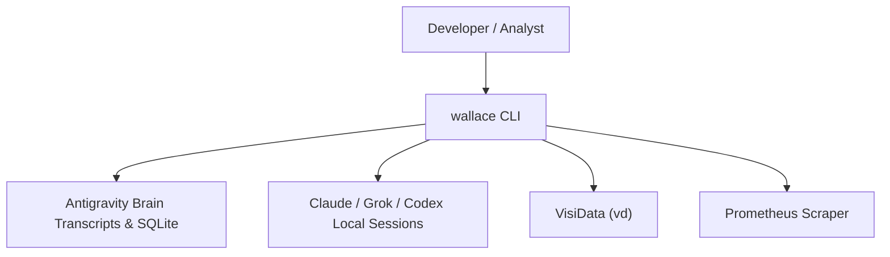
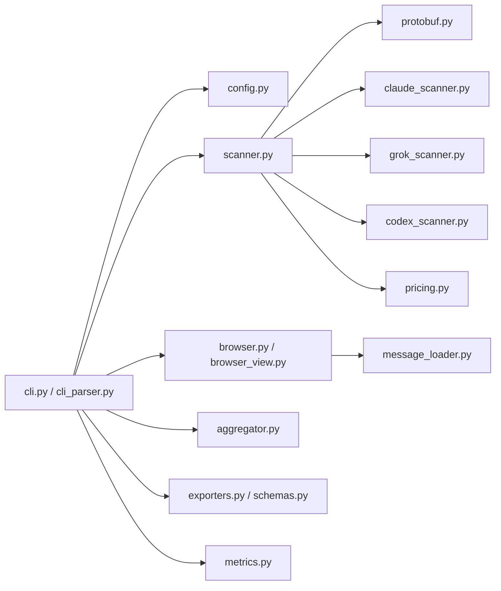
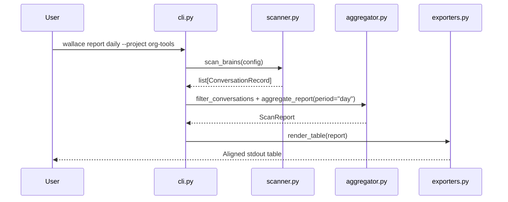

# Architecture (`arc42`)

This document follows the 12-section `arc42` template to explain `wallace`'s internal structure, constraints, runtime flow, and contributor verification gates.

## 1. Introduction and Goals

`wallace` provides a local-first forensic token and USD cost ledger across Antigravity IDE, Antigravity CLI, Claude Code, Grok CLI, and OpenAI Codex session directories without modifying any provider files.

## 2. Architecture Constraints

- **Minimal Runtime Dependencies**: Only `genai-prices`, `jsonschema`, and `prometheus-client` ship at runtime so scans stay fast and deterministic.
- **Zero Lock Contention**: Read-only SQLite URI connections (`?mode=ro`) prevent interference with active agent sessions.
- **Code Craft Bounds**: Every function stays at or below 50 lines and McCabe cyclomatic complexity 10, with strict `mypy` typing and Google-style docstrings.
- **Zero Hardcoded Absolute Paths**: All directories and network bindings remain configurable via TOML, `WALLACE_*` environment variables, or CLI flags.

## 3. System Scope and Context

## 4. Solution Strategy

- Decode per-turn Antigravity model and token fields directly from `conversations/<id>.db` `gen_metadata` using a lightweight zero-dependency protobuf wire reader, paired with turn timestamps from `transcript.jsonl`.
- Fall back transparently to full `transcript.jsonl` parsing when scanning standalone exported brain folders without SQLite sidecars.
- Normalize Antigravity, Claude Code, Grok CLI, and OpenAI Codex sessions into one shared `ConversationRecord` / `TurnUsage` domain model before filtering, aggregation, browsing, or exporting.

## 5. Building Block View

| Module | Responsibility |
| --- | --- |
| `cli.py` & `cli_parser.py` | Noun-verb CLI dispatch, progressive flag disclosure (`--help` vs `--help-all`), and shell completions. |
| `config.py` | Configuration models, TOML loader/serializer, and `WALLACE_*` / `CODEX_HOME` environment overrides. |
| `pricing.py` | Model slug normalization, `genai-prices` catalog lookup, local rate overrides, and deterministic token estimation. |
| `protobuf.py` | Wire-format protobuf decoder for Antigravity `gen_metadata` and `trajectory_metadata_blob`. |
| `claude_scanner.py` & `claude_export.py` | Claude Code `.jsonl` turn deduplication, subagent linking, `.json` exports, and fallback estimation. |
| `grok_scanner.py` | Grok CLI `usage.json` (`costUsdTicks` + cached split) and `chat_history.jsonl` scanner. |
| `codex_scanner.py` | OpenAI Codex `sessions/` and `archived_sessions/` rollout JSONL scanner. |
| `scanner.py` & `resolver.py` | Unified multi-provider discovery plus parent-tree project and feature resolution. |
| `message_loader.py` & `transcript_reader.py` | Normalized multi-provider `ConversationMessage` loader and `conversation read` serializers. |
| `browser.py` & `browser_view.py` | Deterministic `BrowserState`, `80x24`-safe single-viewport layout, and `curses` event loop. |
| `timeframe_bounds.py` & `timeframes.py` | Human/ISO timeframe window bounds and `day`/`week`/`month`/`interval` bucketing. |
| `aggregator.py`, `query.py`, & `task_query.py` | Turn-level filtering, multi-dimensional rollups, single-conversation queries, and Work Package attribution. |
| `exporters.py` & `schemas.py` | Table, TSV, plain, JSON, JSONL, formula-sanitized CSV serializers, and JSON Schema / CSVW contract generators. |
| `visidata_integration.py` | Six-sheet SQLite workbook builder, `.visidatarc` plugin, and `vd` launcher. |
| `metrics.py` | Bounded Prometheus gauges, counters, text exposition, and HTTP `/metrics` server. |
| `installer.py` | Executable launcher shim installer for `wallace install`. |

## 6. Runtime View

## 7. Deployment View

`wallace` runs either directly via `uv tool install` / `pip` / `mise` on macOS and Linux workstations, or inside a non-root `python:3.13-slim` Docker container mounting host session folders read-only (`:ro`).

## 8. Cross-Cutting Concepts

- **Unix Stream Discipline**: Primary data writes to `stdout`; warnings, prompts, and diagnostics write to `stderr`.
- **Spreadsheet Formula Safety**: String CSV cells starting with `=`, `+`, `-`, `@`, `\t`, or `\r` receive a leading `'` prefix.
- **Schema Zero-Drift**: Every committed file under `schemas/` is verified against `schemas.py` in the automated test suite.

## 9. Architecture Decisions

- **Turn-Level Timeframe Bucketing**: Grouping by `day`, `week`, `month`, or `interval` buckets individual turns so multi-day sessions attribute spend to the exact date each turn ran.
- **Zero-Dependency Protobuf Reader**: Parsing wire tags `0` (varint) and `2` (length-delimited) directly avoids shipping generated protobuf schemas for internal Antigravity blobs.
- **Offline `genai-prices` Catalog**: Bundling pricing offline eliminates network latency and API key requirements during local audits.

## 10. Quality Requirements

Contributors validate all changes through `mise` tasks:

- `mise run verify`: Runs `ruff format --check`, `ruff check`, `mypy --strict`, and `pytest` behavioural and schema-contract tests.
- `mise run docs`: Runs `uv run zensical build --clean --strict` to enforce zero broken links or build warnings.
- `mise run build`: Builds `sdist` and `wheel` artifacts via `uv build --clear`.

## 11. Risks and Technical Debt

- Provider log formats (such as Antigravity SQLite `gen_metadata` field numbers or Codex rollout event schemas) can evolve in future releases. Scanners isolate provider-specific parsing and retain transcript fallbacks where possible so token totals remain auditable.

## 12. Glossary

See the shared [Glossary](../reference/glossary.md) for canonical definitions.
