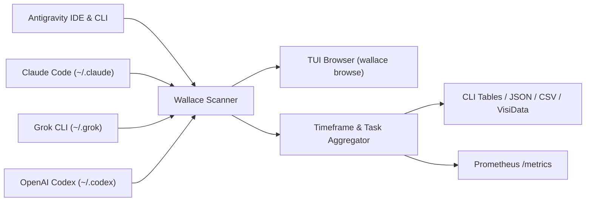

# Wallace Documentation

**Wallace** audits local AI coding agent sessions across Antigravity Integrated Development Environment (IDE), Antigravity Command-Line Interface (CLI), Claude Code, Grok CLI, and OpenAI Codex. It reconciles transcripts into one auditable token and USD spend ledger with an interactive Terminal User Interface (TUI) browser.

## Documentation Structure (Diátaxis)

This documentation follows the [Diátaxis](https://diataxis.fr/) framework. Choose the section that matches your current need:

| Section | Purpose | Start Here When You Want To |
| --- | --- | --- |
| [Tutorials](tutorials/index.md) | Learning-oriented lessons | Install `wallace` and run your first end-to-end audit step by step. |
| [How-to Guides](how-to/index.md) | Goal-oriented recipes | Solve a specific task such as filtering timeframes, customizing pricing, or deploying Prometheus metrics. |
| [Reference](reference/index.md) | Information-oriented lookup | Look up exact CLI flags, TOML keys, environment variables, JSON schemas, or Prometheus metrics. |
| [Explanation](explanation/index.md) | Understanding-oriented background | Learn how pricing, token estimation, subagent attribution, and the internal architecture work. |
