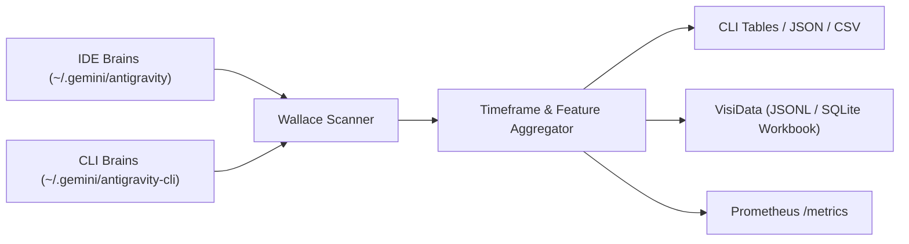

# Wallace Documentation

## Overview

**What you will learn:**

- Why `wallace` audits both Antigravity Integrated Development Environment (IDE) and Command-Line Interface (CLI) brains.
- Which manual matches your role as a user, operator, or contributor.

Antigravity splits agent sessions across IDE workspaces, CLI runs, and isolated subagent worktrees. `wallace` reconciles those trajectories into one auditable ledger of tokens and USD spend.

## Manual Guide

| Manual | Audience | Contents |
| --- | --- | --- |
| [Quickstart](user/quickstart.md) | End users | First scan, project rollups, and custom model pricing. |
| [Timeframes & Conversation Queries](user/timeframes-and-queries.md) | End users & power users | Daily, weekly, monthly, and custom interval spend plus single-conversation JSON queries. |
| [VisiData & Data Schemas](user/visidata-and-schemas.md) | Data analysts & power users | Interactive VisiData workbooks, `.visidatarc` plugin setup, and JSON/CSV schemas. |
| [Docker Runtime & Prometheus Metrics](operations/deployment-and-metrics.md) | Operators | Container deployment, Prometheus scrape metrics, and operational troubleshooting. |
| [Architecture (arc42)](developer/architecture.md) | Contributors | Module boundaries, protobuf decoding, parent-tree resolution, and test workflows. |
| [Glossary](glossary.md) | All readers | Definitions of domain terms and abbreviations. |
